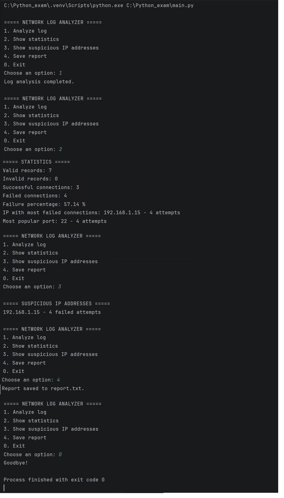

# Аналізатор мережевих журналів

## Опис проєкту

Програма аналізує мережевий журнал із даними про дату й час, IP-адреси, статуси підключень і порти. Вона допомагає підраховувати помилки підключення та знаходити підозрілі IP-адреси.

Проєкт написаний мовою Python і використовує стандартні бібліотеки.

## Можливості

- Читання журналу з файлу `network_log.txt`.
- Перевірка правильності записів.
- Підрахунок успішних і невдалих підключень.
- Обчислення відсотка невдалих підключень.
- Визначення IP-адреси з найбільшою кількістю невдалих спроб.
- Визначення найпопулярнішого порту.
- Виявлення IP-адрес із трьома або більше невдалими спробами.
- Збереження звіту у файл `report.txt`.
- Обробка помилок читання та запису файлів.
- Інтерактивне меню.

## Структура проєкту

```text
Python_exam/
├── main.py
├── network_log.txt
├── report.txt
├── README.md
└── images/
    └── 08_Python_00.jpg
```

## Вимоги

- Python 3
- Файл `network_log.txt`

Додаткові бібліотеки встановлювати не потрібно.

## Запуск програми

Відкрийте термінал у каталозі проєкту та виконайте:

```bash
python main.py
```

## Пункти меню

| Пункт | Дія |
|---|---|
| `1` | Проаналізувати журнал |
| `2` | Показати статистику |
| `3` | Показати підозрілі IP-адреси |
| `4` | Зберегти звіт |
| `0` | Завершити роботу |

## Формат журналу

Кожен запис містить чотири поля, розділені крапкою з комою:

```text
дата_і_час;IP-адреса;СТАТУС;ПОРТ
```

Приклад:

```text
2026-10-18 08:15:10;192.168.1.10;SUCCESS;22
2026-10-18 08:15:15;192.168.1.15;FAILED;22
2026-10-18 08:15:20;192.168.1.15;FAILED;22
2026-10-18 08:15:25;192.168.1.20;SUCCESS;443
```

Допустимі статуси: `SUCCESS` і `FAILED`. Порт повинен бути числом від `1` до `65535`. Некоректні записи рахуються окремо.

## Скріншот роботи програми



## Результат

Програма автоматизує аналіз мережевих журналів, допомагає виявляти повторні невдалі спроби підключення та формує звіт зі статистикою.
